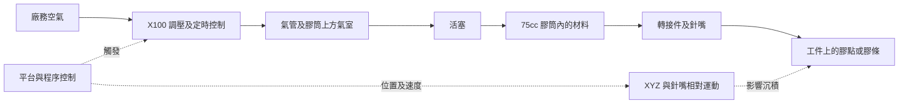
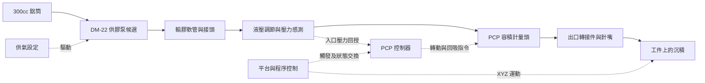

# 系統架構與研究邊界

研究版 v0.2｜2026-10-24。本文是建模前的需求與量測位置整理，沒有建立、擬合或執行動態模型。依使用者指示，進入建模前須另行確認。

後續 v0.3：使用者已授權未取得的數值先以有註記的工程初估補足。真實資料仍依本文標示；虛擬初始配置與可交付開發的規格見第 11、12 份，不再因等待廠商回覆而停住原型準備。尚未實作求解器或介面。

## 1. 收斂的兩組研究配置

| 配置 | 構成 | 現階段定位 |
|---|---|---|
| R75 | Tputty 910／75cc 膠筒／氣壓時間控制／直接針嘴／XYZ | 優先取得可解釋的出膠量與起停資料。控制器參考 Performus X100，平台參考 E3；附件與實際料號待核對 |
| P300 | Tputty 910／300cc 鋁筒／DM-22 25T471 候選／輸膠管路／液壓調節／PCP／C300 | 量產架構候選；Laird 客製升級頭及轉接器未確認，不能宣稱各項選件已能直接組裝 |

Tgrease-2500 保留為第二種材料；待設備適用性與自身試驗資料補齊後再比較，不能套用 910 的流率或 PCP 效率。1 gallon 桶裝、雙液混合與壓合均留作後續擴充。

## 2. R75：氣路、膠路與控制分開記錄

這是本專案研究用功能圖，並非原廠配管圖。暫以「膠筒直接接針嘴」降低待辨識變數；若加入膠液軟管或出膠閥，必須另建配置記錄。

| 研究量測點 | 應記錄什麼 | 為何需要 |
|---|---|---|
| R-A：控制器輸出／膠筒氣室附近 | 氣壓隨時間、量測位置、氣管尺寸 | 調壓器設定值不等於膠筒瞬時壓力 |
| R-B：活塞與膠筒 | 剩餘膠量、活塞位置、氣室體積、摩擦資訊 | 同一壓力與開膠時間可能隨裝填量改變 |
| R-C：針嘴上游 | 可行時量膠液壓力；註明感測器新增死體積 | 氣壓經活塞後不能未驗證就視為針嘴入口壓力 |
| R-D：出口／工件 | 積分重量、起停影像、輪廓、同步位置 | 把控制響應與材料成形分開觀察 |

若無法裝 R-C 感測器，可研究整組「氣壓指令→實際出膠」關係；須標示無法單獨辨識氣路、活塞與針嘴壓降。

## 3. P300：供膠泵與計量頭是不同功能

此圖以 Laird 910 指南第 4 頁與 Graco 官方 PCP 安裝架構作研究整理。[A][B] 調節器位置、感測器位置及實際接頭須以廠商整套圖面取代。不能把 PCP 的控制器輸出流率直接當成獨立量測的出口流率。

建議分別記錄：P-A 供膠泵供氣、P-B 泵後液壓、P-C PCP 入口液壓、P-D PCP 出口／針嘴前液壓，以及出口重量與影像。若 P-D 沒有感測器，不能從 P-C 單獨求出計量頭與針嘴各自的壓降。

### 已查到的具體 PCP 候選與版本差異

Graco 3A5364L（2025-07，第 40 頁）列 25B192／25B193／25B055，排量分別為 0.30／1.00／1.45 cc/rev，最大轉速 300 rpm、工作壓力上限 290 psi。[C] **先以 25B192 作資料卡候選**，但 Laird「upgraded PCP」是否為此系列、哪個 Series、是否加裝抗磨耗零件，仍未知。

3B0393C 的系統料號 2010630 對應 0.30cc 的 25B192。自動 Shot 與 Bead 控制不同：前者觸發一次依目標量執行，後者由持續訊號維持出膠；手冊對自動 Shot 的啟動訊號要求 >200 ms。它是訊號要求，**不是已量到的出膠延遲或最短膠點時間**。回吸另設速率與時間；第 41 頁時序圖沒有可換算成實際流動延遲的時間刻度。[B，頁 3、14、19–21、41–42]

舊 UniXact 型錄的 1–400 rpm、最大入口 116 psi 留在舊資料卡。新版手冊的 300 rpm／290 psi 不可與舊型錄拼成一個規格，也不能把「工作壓力」自動改名為「允許入口壓力」。目前選定組合的入口操作窗口保持未定。

### 液壓調節器候選

官方 PCP 系統引用 High Pressure Elite 調節器手冊。2008938 的最大入口 4000 psi、調壓範圍 70–900 psi、最大控制氣壓 85 psi，液路接口 3/4 G(F)。[D，頁 15] 這提供可追查的候選料號，但沒有證明它等於 Laird 指南的升級轉接器，也不能因調節器可到 900 psi，就讓下游 PCP 使用 900 psi。適用膠量下的調節穩定性、壓降、脈動及下游限制仍待確認。

## 4. 針嘴資料可以具體化，但不能偷換原測試條件

Nordson 官方表列聚乙烯針嘴 **7018555**：內徑 0.125 吋、長度 2.5 吋，換算為 3.175 mm、63.5 mm。[E] 公制欄另標 0.318 cm，屬原廠標示取整；不解讀成尺寸公差。

它可作第一個「可向廠商索取工程圖」的針嘴候選。63.5 mm 是表列整體長度，尚不能當等內徑有效流道長度；錐度、入口、接頭、耐壓及與 75cc cartridge 的適配都待核對。它與 Laird 的 0.125 吋指南針嘴是否相同，也待確認。**910 TDS 的 75 g/min 不會因此自動變成這支針嘴的性能。**

## 5. 動態量測應涵蓋的事件

以下是研究事件清單，不是已實作的狀態機。各事件可能重疊，順序需由實際控制器與軌跡驗證。

| 事件 | 需同步記錄 | 主要待解問題 |
|---|---|---|
| 裝填、回溫與排膠 | 批次、膠溫、排出量、起始剩餘量 | 初始條件是否一致 |
| 待機與穩壓 | 等待時間、壓力、滴漏、材料受壓歷史 | 停留後是否改變首次出膠 |
| 開始點膠 | 觸發時間、實際壓力、轉動、首次出膠影像 | 電控延遲與流動延遲分別多少 |
| 連續點膠／走線 | 指令與實際速度、流量證據、膠形 | 轉角、加減速、供料脈動的作用 |
| 停止與回吸 | 停止指令、實際轉動、尾膠量、回吸設定 | 是否有殘流、吸入空氣或欠膠 |
| 抬針與靜置 | Z 軌跡、斷絲、線寬／線高隨時間 | 分辨抬針拉絲與材料塌陷 |
| 重啟 | 停留長短、首次與後續膠點 | 觸變恢復、析油或供料不足 |

## 6. 研究支持程度與下一階段邊界

| 能力 | 目前具備 | 還缺什麼 |
|---|---|---|
| 材料／設備／包裝選單規劃 | 可建立有來源的候選資料卡 | 完整相容性與版本核對 |
| 重量、體積、容量換算 | 密度典型值與裝填量 | 批次／含氣狀態及殘膠實測 |
| 指定組合穩態出膠預測 | 910 只有一個暫定參考點 | 多工況壓力或轉速—流量資料 |
| 短點、尾膠、停留後重啟 | 已列量測事件與訊號 | 同步時間資料及驗證 |
| 膠點直徑、線寬、線高 | 已列幾何與表面需求 | 實際基材輪廓與沉積校準 |
| 跨材料、跨針嘴自動預測 | 資料架構可擴充 | 各組合的物性與可轉移性證據 |
| 拉絲、壓合、空洞與熱效能 | 保留研究介面 | 專用量測，非第一輪可宣稱功能 |

只有體積與路徑，不能唯一決定寬度、高度與截面形狀。只有穩態流率，不能唯一決定啟停延遲。即使日後可播放平滑動畫，也須以獨立量測判斷是否有預測能力。

## 7. 來源

- [A] [Laird 910 指南 Rev A](https://www.laird.com/sites/default/files/2024-06/A18720-00%20RevA%20Tputty%20910%20%20Dispensing%20Guideline.pdf)，本地 `sources/Laird/Tputty910_Dispensing_Guideline_RevA.pdf`。
- [B] [Graco PCP 系統 3B0393C](https://www.graco.com/content/dam/graco/tech_documents/manuals/3B0/3B0393/3B0393EN.pdf)，本地 `sources/Equipment/Graco_PCP_System_3B0393EN_C.pdf`。
- [C] [Graco PCP 零件／維護 3A5364L](https://www.graco.com/content/dam/graco/tech_documents/manuals/3A5/3A5364/3A5364EN.pdf)，本地 `sources/Equipment/Graco_PCP_Repair_3A5364EN_L.pdf`。
- [D] [Graco Elite 調節器 3B0400A](https://www.graco.com/content/dam/graco/tech_documents/manuals/3B0/3B0400/3B0400EN.pdf)，本地 `sources/Equipment/Graco_Elite_Regulator_3B0400EN_A.pdf`。
- [E] [Nordson Plastic Nozzles 官方尺寸表](https://www.nordson.com/en/products/efd-products/plastic-nozzles)，2026-10-24 線上查閱；本機下載遭網站拒絕，未宣稱保存網頁副本。

本次目視核對 B 的第 7、41、42 頁、C 的第 40 頁與 D 的第 15 頁；其餘設備及包材來源詳第 06 份研究。
