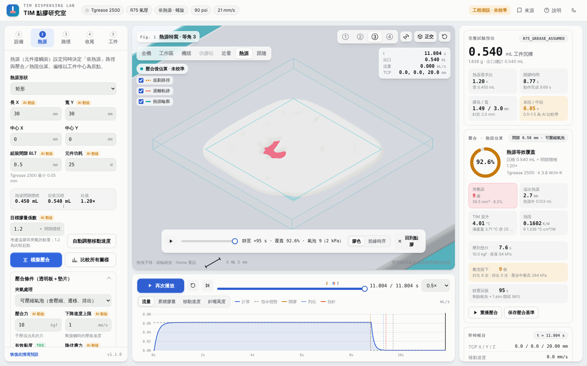

# 第 23 份：v1.1 可壓縮夾氣與墊片壓合

日期：2026-10-30　版本：v1.1.0　狀態：工程假設，未經透明板實測校準

## 1. 為什麼改

v1.0 把「被膠包圍的乾區」直接凍結成不可變形的牆（剛性牆）。這樣有三個問題：

1. 牆不讓膠進去，內圈多出來的膠只能沿著膠線本身繞出去，造成單邊溢膠（Tgrease 螺旋 Ø3 mm、間距 3 mm、2.5 倍膠量時，−y 側溢出 18.7 mm、+y 側只有 3.8 mm）。
2. 被牆完全困住的膠推不出去，出現「未解出」的膠量。
3. 實際透明板只是一片平板，間隙四邊都通大氣，但被膠圍住的空氣到不了邊緣；它會被壓縮、會被膠流帶著走、膠牆變薄時會排出。剛性牆三者都沒有。

使用者的實際壓合條件：**透明平板，以墊片限位控制間隙，壓到墊片即停**。

## 2. 新模型（`simulator/src/compression.js`）

**定力壓合到墊片（第 1 階段）**
- 壓板以固定壓合力（預設 10 kgf，AI 初估）從膠頂往下壓。
- 剛接觸時，速度上限為 1 mm/s。
- 每一步的膜壓由 Hele-Shaw 潤滑方程求得：∇·(h³/12μ ∇p) = −ḣ。
- 每一步的時間由「膜壓總和 = 壓合力」決定，所以壓合時間是算出來的，不是設定的。
- 壓板步長自動調整，讓膠的前緣每步約前進一格。

**可壓縮氣泡**
- 每個被包圍的乾區記錄封住當下的空氣量。
- 之後依等溫 pV = 常數 計算氣壓，並與膜壓聯立（Newton 隱式）求解。
- 氣/膠介面可以雙向移動：
  - 上游側膠壓高於氣壓時，膠流進氣泡，氣泡被壓縮。
  - 下游側膠壓低於氣壓時，氣泡把介面格的膠推回膜內；介面格的膠推空後，空氣才進入下一格，介面維持一格寬。
- 這組運動學同時產生：
  - **壓縮**
  - **遷移**：氣泡隨膠流前進，理想條件下約為膠流速度的兩倍。
  - **吹破**：膠牆被推空時，氣泡接通大氣、排出。
- 氣泡分裂或合併時，氣體量按空氣體積分配。
- 小於「一格 × 墊片間隙」1 atm 體積的氣泡低於網格解析度，視為自由液面，不追蹤。

**墊片定位後靜置（第 2 階段）**
- 壓板不動，膠壓消退，被壓縮的氣泡回脹。
- 回脹停在 Bingham 降伏應力擋得住的壓差：Δp = 2τy·L/h，L 為氣泡到開放前緣的最短膠路徑。
- 觀察時間預設 300 s，建議設成與透明板拍照時間一致。

**對照選項**
- 剛性牆：v1.0 舊模型。
- 全部排出：覆蓋率上限。

## 3. 驗證（`tests/squeeze-physics.test.mjs`，全部 81 項測試通過）

| 檢查 | 結果 |
|---|---|
| 定力壓圓盤的閉合時間 vs Stefan 解析解 | 網格 0.5／0.35／0.25／0.18 mm 誤差 2.5／1.6／1.2／0.9% |
| 氣泡遷移 vs Taylor–Saffman（約 2 倍流速） | 前段誤差 < 2%；接近自由邊界時加速，最後吹破 |
| 中心氣泡、無降伏應力 | 壓合中被壓到 0.21 倍體積（370 kPa，符合 pV）；靜置後回到 1 atm 體積的 99.8%，氣體量守恆到 1e-12 |
| 降伏應力 5000 Pa | 氣泡停在 Bingham 預測的保持壓力 ±5% |
| 質量守恆 | 所有圖樣、三種模式誤差 ~1e-15 mL |
| 數值穩健 | CG 容差 1e-7 到 1e-4 結果相同；乾格判定門檻（1e-3）高於求解誤差 20 倍以上 |
| v1.0 單邊溢膠案例 | 可壓縮：四邊 11.2／11.3／11.2／11.3 mm，覆蓋 97.8%；剛性牆：6.7／11.8／18.7／3.8 mm，覆蓋 79.9% |

## 4. 三種處理方式比較（30 × 30 mm 熱源、0.5 mm 墊片、膠量 1.2 倍、網格 0.5 mm、10 kgf）

格式為「覆蓋率／夾氣處數・mm²」。

註：Tputty 的蛇形與螺旋在目前的加速度與轉角限制下達不到 1.2 倍膠量。實際沉積約為需求的 2.8–3 倍（圖樣比較表會標 ⚠），所以它們的溢膠與壓合時間偏大。

| 膠材 | 圖樣 | 剛性牆 v1.0 | 可壓縮（預設） | 全部排出 | 壓到墊片 s | 封住／排出次數 | 壓合中最高氣壓 kPa |
|---|---|---|---|---|---|---|---|
| Tgrease 2500 | n | 79.8% / 0・0 | 81.3% / 3・3 | 81.6% / 0・0 | 10 | 11 / 0 | 337 |
| Tgrease 2500 | serpentine | 91.3% / 3・53 | 94.1% / 4・21 | 97.1% / 0・0 | 11 | 3 / 1 | 310 |
| Tgrease 2500 | spiral | 90.5% / 6・80 | 92.6% / 9・56 | 98.9% / 0・0 | 8 | 6 / 0 | 284 |
| Tgrease 2500 | perimeter | 75.3% / 0・0 | 75.3% / 0・0 | 75.3% / 0・0 | 6 | 0 / 0 | 0 |
| Tgrease 2500 | line | 82.8% / 1・12 | 89.8% / 0・0 | 89.9% / 0・0 | 17 | 4 / 4 | 6 |
| Tputty 910 | n | 77.0% / 0・0 | 78.4% / 0・0 | 78.5% / 0・0 | 19 | 6 / 0 | 0 |
| Tputty 910 | serpentine | 86.5% / 4・122 | 96.9% / 2・27 | 100.0% / 0・0 | 190 | 8 / 7 | 201 |
| Tputty 910 | spiral | 94.7% / 11・46 | 99.0% / 7・6 | 100.0% / 0・0 | 219 | 21 / 15 | 349 |
| Tputty 910 | perimeter | 45.0% / 1・495 | 47.8% / 0・0 | 73.6% / 0・0 | 50 | 1 / 1 | 143 |
| Tputty 910 | line | 93.4% / 0・0 | 93.4% / 0・0 | 93.4% / 0・0 | 45 | 0 / 0 | 0 |

畫面（Tgrease 螺旋，同上條件）：

- 壓到墊片瞬間，氣泡被壓縮（約 220 kPa）：`simulator/qa/v1.1/01-press-seated.png`
- 靜置 95 s 後回脹：`simulator/qa/v1.1/02-press-relaxed.png`
- v1.0 剛性牆對照：`simulator/qa/v1.1/05-rigid-wall-v1.0.png`

**解讀**

- **可壓縮結果落在剛性牆與全部排出之間。** 剛性牆高估夾氣，並造成不對稱溢膠。
- **Tgrease 的氣泡多半留下。** 黏度較低、壓合快，氣泡來不及遷移出去。墊片定位後，氣泡幾乎回脹到 1 atm 體積（約 98%）。回脹時的足跡會比「剛封住時」更大，因為間隙已變薄。
- **Tputty 的氣泡較多排出。** 壓合慢（10 kgf 下約 3 分鐘），氣泡有時間被膠流帶到邊緣。
  - Tputty 在 0.5 mm 需要很大的力或很長的時間才壓得到。這點與 Stefan 公式一致：螺旋實際沉積約 1.3 mL，同體積圓盤以 10 kgf 也要約 4 分鐘。壓合時間與膠量平方成正比、與壓合力成反比。
- **外框（picture-frame）中央氣泡會吹破膠牆排出。** 但中央大片沒有膠，覆蓋率仍低。

## 5. 參數與來源（介面右上「來源」標記為「v1.1 更新」）

**有效黏度（壓合）**
- Tgrease 2500 = 2500 Pa·s：TDS Brookfield 2 rpm，與設備頁同步。
- Tputty 910 ≈ 7000 Pa·s：推導值。
  - 由 90 psi、75 g/min 與冪律 m = 2.7 反推 K ≈ 7.3×10³ Pa·sⁿ，取 1 s⁻¹ 的視黏度。
  - 推導假設 90 psi 全部落在針嘴，所以偏高。

**降伏應力**
- 廠商未公開。
- 文獻實測（Nagrani et al., J. Rheol. 2023）：DOWSIL TC-5550 約 7–10 Pa，TC-5622 約 30 Pa。
- 本版 AI 初估：Tgrease 2500 = 50 Pa，Tputty 910 = 200 Pa。
- 以 L = 5 mm、h = 0.5 mm 計，只擋得住 1–4 kPa。因此模型預測：**墊片壓合後，氣泡幾乎回脹到 1 atm 體積**。

**壓合條件（AI 初估，可在熱源頁修改）**
- 壓合力 10 kgf。
- 下降速度上限 1 mm/s。
- 靜置觀察 300 s。

## 6. 界線

- **等效牛頓黏度。** Tputty 的剪切稀化（n ≈ 0.37）未納入，所以壓合時間只是量級。
- **降伏應力只用在墊片定位後的回脹。** 壓合中，它對氣泡遷移的阻力未納入，因此遷移與排出可能偏多。
- **吹破只是一階近似。** 指狀穿透（Saffman–Taylor）只能用網格一階近似：吹破的位置與時機受網格影響，夾氣數量也隨網格改變。例如上例 Tgrease 螺旋：
  - 網格 0.75 mm：覆蓋 93.4%
  - 網格 0.6 mm：覆蓋 96.0%
  - 網格 0.5 mm：覆蓋 97.8%

  比較圖樣請用相同網格，建議 ≤ 0.5 mm。
- **未含的效應：**
  - 表面張力：約 0.1 kPa，可忽略。
  - 接觸線釘扎與壁滑。
  - 氣體溶解。
  - 溫度。
- **膠形來自既有的沉積模型。** 部分慢速圖樣在起點堆得很高（數 mm），會影響最早封住的高度。

## 7. 建議的透明板驗證

1. 用與模擬相同的墊片厚度、膠量與圖樣。記錄壓合力（或改用重物），以及壓到墊片的秒數。
2. 壓到墊片後，在 0 s、30 s、2 min、10 min 各拍一張。
   - 若氣泡隨時間變大，代表墊片定位後的回脹存在。
   - 回脹的幅度可用來反推降伏應力。
3. 量測每個氣泡的面積與位置，和模擬的「夾氣區」比對。若實際氣泡明顯更多、更靠中央，代表遷移被高估，需要加入壓合中的降伏應力阻力。
4. 壓合時間和模擬差很多時，先調「有效黏度」。

## 8. v1.1.1 修正：薄膠層時壓板沒壓到墊片

**使用者回報**
- 條件：Tgrease 方形螺旋、間距 1.5 mm、Ø2 mm 針嘴、墊片 0.05 mm。
- 只改移動速度：100 mm/s 出 0.088 mL，50 mm/s 出 0.129 mL。
- 現象：膠多的反而覆蓋率較低、溢膠較少。

**這不是物理現象，是模擬器錯誤**
- 兩次都用完 600 步的步數上限，壓板停在約 0.2 mm 就被直接跳到間隙。
- 結果 41%／66% 的膠沒有被推開，還留在原地。
- 原因是「氣泡被壓扁就縮小步長」的保護誤判：壓板把細長氣道切成幾段時，拿其中一段的空氣量和整個原氣泡比，誤以為被壓扁。實際上氣量按空氣分配，每段壓力不變。

**修正**
- 改用「絕對氣壓單步升高超過 1.8 倍」判斷是否被壓扁。
- 步數超過 900 時，剩下的行程改用粗步長完成並加上警告，不再跳到間隙。

**修正後（網格 0.5 mm、10 kgf）**

| 速度 | 膠量（× 間隙體積） | 覆蓋率 | 溢出 | 夾氣 | 壓到墊片時間 |
|---|---|---|---|---|---|
| 100 mm/s | 0.088 mL（1.95×） | 96.1% | 7.9 mm | 13 處 27 mm² | 約 52 min |
| 50 mm/s | 0.129 mL（2.87×） | 98.0% | 13.4 mm | 9 處 9.5 mm² | 約 1.9 h |

- **溢膠：** 膠多溢得多。
- **覆蓋：** 兩者都接近滿，膠多的略高；多出來的膠把更多氣泡推出去了。
- **壓合時間：** 比值約 2.2 倍，與 Stefan 公式的「時間 ∝ 膠量²」一致。
- **0.05 mm 是很薄的膠層：** 以 10 kgf 要近一小時才壓得到。手壓實際上會用更大的力，或膠量應接近 1.2 倍。
- **靜置：** 300 s 後，剩餘氣泡仍約為 1 atm 體積的 0.6–0.7。薄膠層裡膠壓消退得很慢（時間常數 ∝ 1/h²）。

已加入回歸測試（`tests/squeeze-physics.test.mjs`）。

## 9. 下一步

依使用者要求，氣泡遷移與吹破之後要再深化：

- **遷移：** 本版已有一階版本（介面運動學）。之後可加入壓合中的降伏應力與接觸線阻力，讓小氣泡不會過度遷移。
- **吹破：** 本版靠網格解析膠牆排空。之後可加入顯式的破裂準則（例如膠牆厚度與壓差、指狀不穩定的波長），降低對網格的依賴。
- **校準：** 兩者都需要透明板照片來決定係數。
