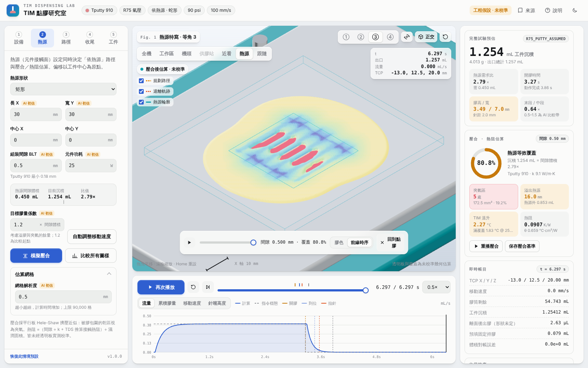

# TIM 點膠機台動態模擬器

目前版本 **v1.0.0**（2026-10-30）：接手後全面修正計算與介面——Tputty 壓力冪次改依 Laird 點膠指南曲線（m = 2.7）、多段路徑轉角減速、壓合改為 Hele-Shaw 擠壓並偵測夾氣、新增一維熱阻／溫升、圖樣比較與自動調速，以及彩色 3D 與全新工作台介面。詳見 [第 22 份：v1.0 接手全面修正與驗證](22_v1.0接手全面修正與驗證.md)。

**工程假設／尚未經實機校準。** 本版用於比較明示假設下的參數、路徑與壓合方案，尚不能可靠替代真機試驗。膠材初始值、推估與來源均保留註記。

## 開啟模擬器

Windows 安裝 Node.js 後，雙擊 `simulator/啟動模擬器.cmd`，瀏覽器開啟 http://127.0.0.1:5173/ 。本版附有建置檔 `simulator/dist`，可直接啟動，不必先安裝開發套件。服務只監聽本機；工件在本機讀取。

重新開發／建置：

```powershell
cd simulator
npm ci
npm test
npm run build
npm run dev
```

開發服務與正式啟動器使用同一個連接埠，請勿同時啟動。

## 本版功能

- Tputty 910、Tgrease 2500；R75 氣壓時間式、P300 理想 PCP。
- 依熱源路徑（中心線、N、蛇形、螺旋、外框）、直線、單點；轉角依 junction deviation 減速。
- 出膠起停、提前關膠、退離動作、PCP 反轉、庫存與體積對帳。
- 透明板壓合動畫、覆蓋率、夾氣、溢膠距離、熱阻與溫升；五種圖樣等膠量比較；依熱源體積自動調整速度。
- 彩色 3D：桌上型龍門、拖鏈、控制器即時顯示、C300／DM-22／PCP 參考外形；正交等角 ①–④、自由旋轉、透視、熱源特寫與跟隨。
- STL、GLB、內嵌 glTF 工件匯入；配置 JSON、結果 CSV、畫面 PNG 匯出；深色／淺色主題。



## 資料位置

| 路徑 | 內容 |
|---|---|
| 根目錄 00–22 文件 | 研究、廠商詢問信草稿、建模規格、各版交付與驗證 |
| data/ | 原始參數與視覺需求 |
| sources/ | 廠商資料及來源清單；Anatomy 來源與固定版本備份 |
| research_checks/ | 研究期驗證程式 |
| simulator/src/ | 計算、三維場景與介面程式 |
| simulator/tests/ | 測試及已知尺寸工件 |
| simulator/qa/ | 驗收紀錄、畫面與匯出範例 |
| simulator/dist/ | 本版可直接啟動的建置檔 |

[操作說明](simulator/README.md) · [驗收紀錄](simulator/qa/驗收紀錄.md) · [開發設計](simulator/DESIGN.md)

歷史文件中的本機路徑與授權狀態保留原樣；目前實作狀態以第 22 份文件與 simulator/README.md 為準。來源參數檔不因備份而變更；v1.0 查證後的更新放在 `simulator/src/parameters.js`。

## 備份與第三方資料

上傳包含開發成果與原始研究資料；不包含可重建的 node_modules（v1.0 起已自版本控制移除）、空白暫存目錄、日誌或環境憑證。套件版本由 package-lock.json 鎖定。

廠商 PDF／網頁保留於私人儲存庫作研究溯源，其權利仍屬各原權利人。Anatomy 固定於 `1482e8469b0a9e0d8cc18ea2740a01423d29ae80`，備份包含原 MIT LICENSE；只研讀其設計原則，模擬器渲染採 Three.js。Three.js 隨建置檔分發的授權見 `sources/Licenses/three-LICENSE.txt`。本儲存庫未對專案自身另授開源授權。
