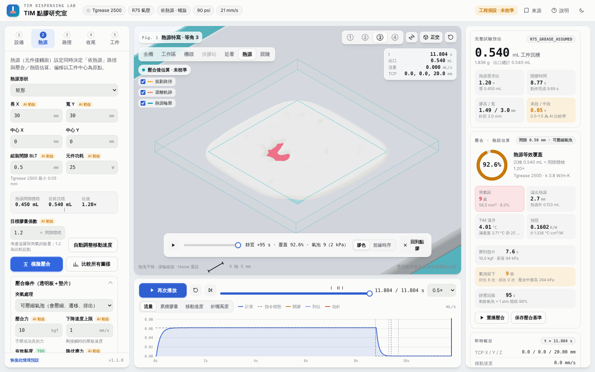

# TIM 點膠機台動態模擬器

目前版本 **v1.5.0**（2026-11-04）：
- 重新審核自動最佳化：
  - 篩選改在決策區，以劑量階梯真值驗證；
  - 只有細網格複核過的結果才算達標；
  - 膠量反推快約 4 倍。
- 新增四個搜尋精細度，依這台電腦估算時間。
- 多執行緒並行。
- 搜尋中可停止並保留部分結果。

詳見 [第 26 份：v1.5 最佳化審核與搜尋精細度](26_v1.5最佳化審核與搜尋精細度.md)。

v1.4.0：
- 左上新增固定的「膠量列」：目標可用 × 需求、mL 或 g；預設先調壓力或轉速，到極限才改速度。
- 圖樣比較、自動最佳化、情境比較移到頂部工具列。
- 分頁依流程重排：熱源工件 → 膠材設備 → 路徑 → 收尾 → 壓合。
- 單點與直線也能自動最佳化。
- 膠條與膠點的形狀改由針嘴離面高度決定：針距低於膠的自然高度時壓平變寬，壓不開時標示埋針。

詳見 [第 25 份：v1.4 膠量列、分頁重整、單點／直線最佳化與針距膠形](25_v1.4膠量列分頁重整與針距膠形.md)。

v1.3.0：自動最佳化改為「製程窗口」——膠量 ±10% 內都達標才算數，膠量以壓力／轉速優先調整，並檢查針嘴與膠條匹配；設計理由見 [第 24 份：v1.3 製程窗口最佳化與針嘴匹配](24_v1.3製程窗口最佳化與針嘴匹配.md)。v1.2.0：新增「情境比較」（存下多組試過的參數，一次依覆蓋目標、溢膠上限與膠量排序比較）與「自動最佳化」（固定圖樣與熱源，搜尋膠量、間距與內縮）。v1.1.1 修正薄膠層時壓板未壓到墊片。v1.1：壓合改為「定力壓到墊片 + 可壓縮夾氣」——被膠包圍的空氣依 pV = 常數 壓縮，可隨膠流遷移、在膠牆變薄時排出，壓到墊片後再依降伏應力回脹；壓合時間對 Stefan 解析解、氣泡遷移對 Taylor–Saffman 驗證。v1.0 的剛性牆與全部排出保留為對照。詳見 [第 23 份：v1.1 可壓縮夾氣與墊片壓合](23_v1.1可壓縮夾氣與墊片壓合.md)。

v1.0.0：接手後全面修正計算與介面——Tputty 壓力冪次改依 Laird 點膠指南曲線（m = 2.7）、多段路徑轉角減速、Hele-Shaw 壓合與夾氣、一維熱阻／溫升、圖樣比較與自動調速，以及彩色 3D 與全新工作台介面。詳見 [第 22 份：v1.0 接手全面修正與驗證](22_v1.0接手全面修正與驗證.md)。

**工程假設／尚未經實機校準。** 本版用於比較明示假設下的參數、路徑與壓合方案，尚不能可靠替代真機試驗。膠材初始值、推估與來源均保留註記。

## 開啟模擬器

**網頁版（免安裝）：https://tedus-ai.github.io/TIM-Dispensing-Simulator/**　main 分支的 `simulator/` 更新後，由 GitHub Actions 自動測試、建置並部署到 GitHub Pages。

本機版：
Windows 安裝 Node.js 後，雙擊 `simulator/啟動模擬器.cmd`，瀏覽器開啟 http://127.0.0.1:5173/ 。本版附有建置檔 `simulator/dist`，可直接啟動，不必先安裝開發套件。服務只監聽本機；工件在本機讀取。

重新開發／建置：

```powershell
cd simulator
npm ci
npm test
npm run build
npm run dev
```

開發服務與正式啟動器使用同一個連接埠，請勿同時啟動。

## 本版功能

- Tputty 910、Tgrease 2500；R75 氣壓時間式、P300 理想 PCP。
- 依熱源路徑（中心線、N、蛇形、螺旋、外框）、直線、單點；轉角依 junction deviation 減速。
- 出膠起停、提前關膠、退離動作、PCP 反轉、庫存與體積對帳。
- 透明板定力壓到墊片的動畫：膠膜擴散、氣泡壓縮／遷移／排出、靜置回脹；覆蓋率、夾氣、溢膠距離、壓合時間、熱阻與溫升。
- 膠量列：依目標膠量自動調壓力／轉速（到極限才改速度）或速度、開膠時間；五種圖樣等膠量比較；情境比較；製程窗口自動最佳化（圖樣、直線、單點）。
- 彩色 3D：桌上型龍門、拖鏈、控制器即時顯示、C300／DM-22／PCP 參考外形；正交等角 ①–④、自由旋轉、透視、熱源特寫與跟隨。
- STL、GLB、內嵌 glTF 工件匯入；配置 JSON、結果 CSV、畫面 PNG 匯出；深色／淺色主題。



## 資料位置

| 路徑 | 內容 |
|---|---|
| 根目錄 00–26 文件 | 研究、廠商詢問信草稿、建模規格、各版交付與驗證 |
| data/ | 原始參數與視覺需求 |
| sources/ | 廠商資料及來源清單；Anatomy 來源與固定版本備份 |
| research_checks/ | 研究期驗證程式 |
| simulator/src/ | 計算、三維場景與介面程式 |
| simulator/tests/ | 測試及已知尺寸工件 |
| simulator/qa/ | 驗收紀錄、畫面與匯出範例 |
| simulator/dist/ | 本版可直接啟動的建置檔 |

[操作說明](simulator/README.md) · [驗收紀錄](simulator/qa/驗收紀錄.md) · [開發設計](simulator/DESIGN.md)

歷史文件中的本機路徑與授權狀態保留原樣；目前實作狀態以第 22–26 份文件與 simulator/README.md 為準。來源參數檔不因備份而變更；v1.0 查證後的更新放在 `simulator/src/parameters.js`。

## 備份與第三方資料

上傳包含開發成果與原始研究資料；不包含可重建的 node_modules（v1.0 起已自版本控制移除）、空白暫存目錄、日誌或環境憑證。套件版本由 package-lock.json 鎖定。

廠商 PDF／網頁保留於本儲存庫作研究溯源，其權利仍屬各原權利人。Anatomy 固定於 `1482e8469b0a9e0d8cc18ea2740a01423d29ae80`，備份包含原 MIT LICENSE；只研讀其設計原則，模擬器渲染採 Three.js。Three.js 隨建置檔分發的授權見 `sources/Licenses/three-LICENSE.txt`。本儲存庫未對專案自身另授開源授權。
