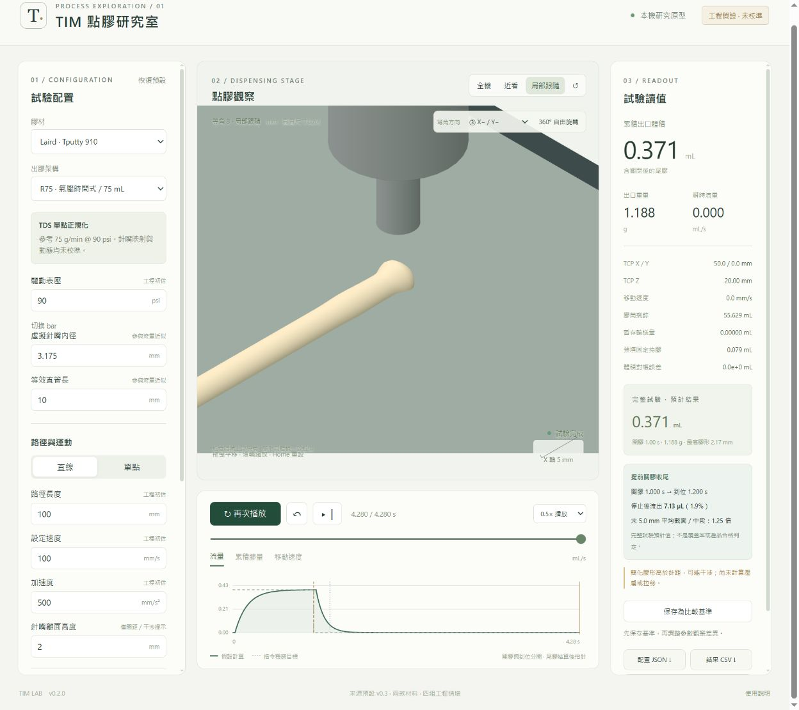

# TIM 點膠機台動態模擬器

目前本機開發版本 v0.4.0（2026-10-28），依公開圖面修正膠筒、針嘴與 C300／DM-22 參考外形，並加入支架與示意管路。詳見 [v0.4 來源與尺寸](19_v0.4原廠外形尺寸與機構驗證.md)。

**工程假設／尚未經實機校準。** 本版用於比較明示假設下的參數與操作流程，尚不能可靠替代真機試驗。膠材初始值、推估與來源均保留註記。

## 開啟模擬器

Windows 安裝 Node.js 後，雙擊 `simulator/啟動模擬器.cmd`，瀏覽器開啟 http://127.0.0.1:5173/ 。本版附有建置檔 `simulator/dist`，可直接啟動，不必先安裝開發套件。服務只監聽本機；工件在本機讀取。

重新開發／建置（本版使用 Node.js 24）：

```powershell
cd simulator
npm ci
npm test
npm run build
npm run dev
```

開發服務與正式啟動器使用同一個連接埠，請勿同時啟動。

## 本版功能

- Tputty 910、Tgrease-2500；R75 氣壓時間式、P300 理想 PCP。
- 單點／直線試驗、出膠起停與尾膠、庫存、體積對帳及基準比較。
- 真實毫米比例、四向等角、360° 自由環繞、全機／近看／局部跟隨。
- STL、GLB、內嵌資源 glTF 工件顯示與尺寸換算；尚未支援曲面沉積或完整碰撞。
- 配置 JSON、快照 CSV、畫面 PNG 匯出。
- 原廠典型尺寸參考的 75 cc 裸筒與候選針嘴，以及 C300／DM-22／PCP 外形；其他部件與管路為工程示意，非精確原廠 CAD。



## 資料位置

| 路徑 | 內容 |
|---|---|
| 根目錄 00–19 文件 | 研究、廠商詢問信草稿、建模規格、交付與機構來源 |
| data/ | 原始參數與視覺需求 |
| sources/ | 廠商資料及來源清單；Anatomy 來源與固定版本備份 |
| research_checks/ | 研究期驗證程式 |
| simulator/src/ | 計算、三維場景與介面程式 |
| simulator/tests/ | 測試及已知尺寸工件 |
| simulator/qa/ | 驗收紀錄、畫面與匯出範例 |
| simulator/dist/ | 本版可直接啟動的建置檔 |

[操作說明](simulator/README.md) · [驗收紀錄](simulator/qa/驗收紀錄.md) · [開發設計](simulator/DESIGN.md)

歷史文件中的本機路徑與授權狀態保留原樣；目前實作狀態以第 19 份文件與 simulator/README.md 為準。來源參數檔不因備份而變更。

## 備份與第三方資料

上傳包含開發成果與原始研究資料；不包含可重建的 node_modules、空白暫存目錄、日誌或環境憑證。套件版本由 package-lock.json 鎖定。

廠商 PDF／網頁保留於私人儲存庫作研究溯源，其權利仍屬各原權利人。Anatomy 固定於 `1482e8469b0a9e0d8cc18ea2740a01423d29ae80`，備份包含原 MIT LICENSE；只研讀其設計原則，模擬器渲染採 Three.js。Three.js 隨建置檔分發的授權見 `sources/Licenses/three-LICENSE.txt`。本儲存庫未對專案自身另授開源授權。
